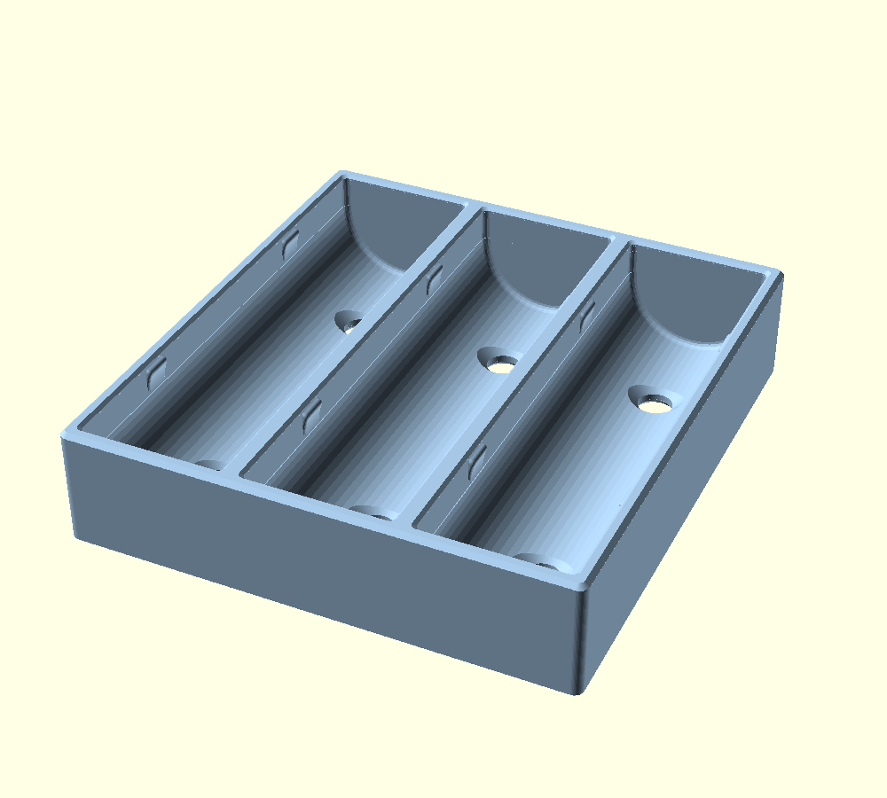
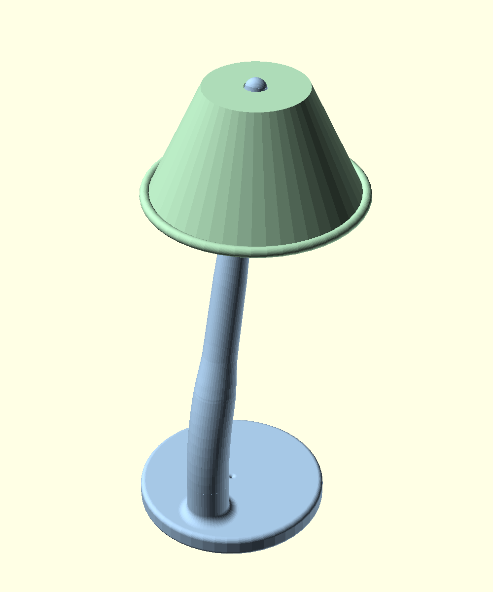
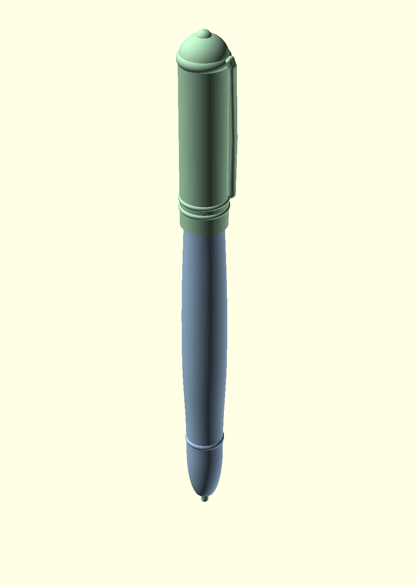

# OpensCAD

A Blueprint workspace for parametric OpenSCAD parts aimed at FDM printing.

Confirmed design decisions live in each design’s `BLUEPRINT.md` so later iterations cannot quietly drop them — the usual failure mode of a long chat with no locked spec. One design folder can hold several objects; each object has its own section in that Blueprint and its own Customizer checkbox.

## Setup

Follow [docs/setup-environment.md](docs/setup-environment.md). Quick script:

```powershell
powershell -File scripts/setup-environment.ps1
```

That installs the OpenSCAD Cursor extensions and ensures an OpenSCAD **Nightly** CLI when none is present (minimum **2025.01.01**).

## Layout

```
samples/<name>/                  Shipped example designs (see below)
  BLUEPRINT.md                   Specs for that sample only
  <name>.scad                    Implementation (+ preview.png screenshot)
designs/<name>/                  Your designs, one folder each
  BLUEPRINT.md                   Specs for that design only
  <name>.scad
lib/                             Shared OpenSCAD helpers (not a design)
exports/                         Generated meshes — .stl and .3mf (gitignored)
docs/                            Scope and toolchain setup
.cursor/rules/                   Agent authoring rules (not part geometry)
scripts/                         Environment setup and mesh export
Makefile                         make exports / make part
```

**`samples/`** holds complete example designs that ship with the repo. Each subdirectory is one design: its own Blueprint, OpenSCAD file(s), and a `preview.png`. Use them to learn the workflow or as a starting point; do not treat a sample as the active design unless you are editing that sample. New work belongs under `designs/`.

## Samples

| | |
|:--|:--|
|  |  |
| `samples/cell_holder_18650_x3/` | `samples/desk_lamp/` |
|  | |
| `samples/pen/` | |

Open any sample `.scad` in the **OpenSCAD** desktop app → **Window → Customizer** → **F5**. Multi-object designs use `show_<object>` checkboxes so each Blueprint object can be hidden on its own. `export_format` chooses **STL** or **3MF**.

In-editor preview: open a `.scad` and press **Ctrl+Shift+V**, or Command Palette → **Show OpenSCAD Preview**. Object colors need 3MF preview + lazy union + `scripts/openscad-cli.exe` (built by the setup script). Reload the Cursor window after setup; leave the Colors toggle on.

## Blueprint shape (objects stay locked)

Each design directory has one Blueprint. Several objects live as separate sections so a later change to one cannot rewrite the others:

```markdown
## Design
1. Shared relationship between objects…

## Objects

### barrel
1. Rules for the barrel only…

### cap
1. Rules for the cap only…
```

Tell an agent which design you mean by opening a file in that folder, and which object by its `###` name. Specs for that object stay in that section; other objects stay as already confirmed.

## Start a new design

1. Create `designs/<name>/`.
2. Add `BLUEPRINT.md` (see [designs/README.md](designs/README.md)).
3. Add `<name>.scad` with `include <../../lib/fdm.scad>;`, one `show_<object>` per Blueprint object, and `export_format`.
4. Do not copy a sample Blueprint unless you mean to fork that sample.

## Export meshes

Each Blueprint object exports as its own file so the slicer loads separate parts:

```bash
make exports
make part PART=samples/<name>/<name>
make part PART=samples/<name>/<name> OBJECT=<object>
make exports FORMAT=3MF
```

Or:

```powershell
powershell -File scripts/export-meshes.ps1 -Part samples/<name>/<name>
```

STL and 3MF both land under `exports/` (same tree). Example pattern: `exports/samples/<name>/<name>_<object>.stl` (or `.3mf`).

Override the OpenSCAD binary if needed:

```bash
make exports OPENSCAD="C:/Program Files/OpenSCAD/openscad.exe"
```
